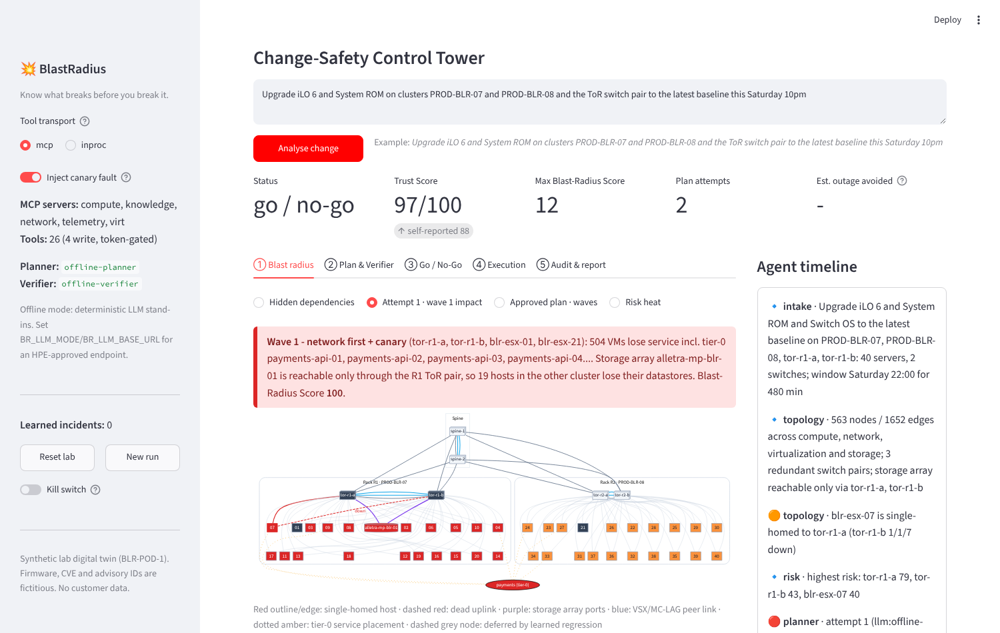
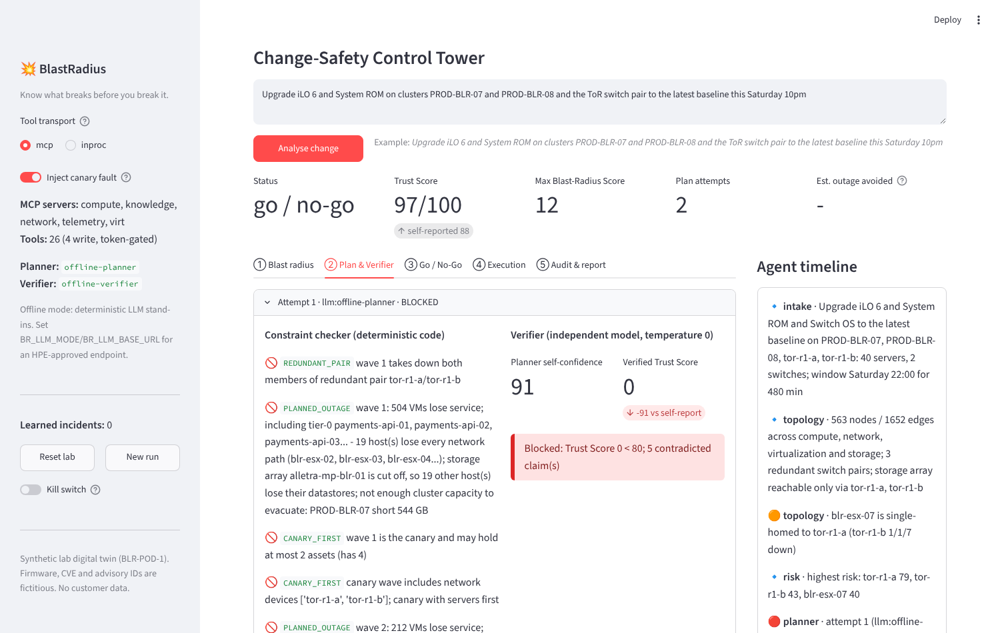
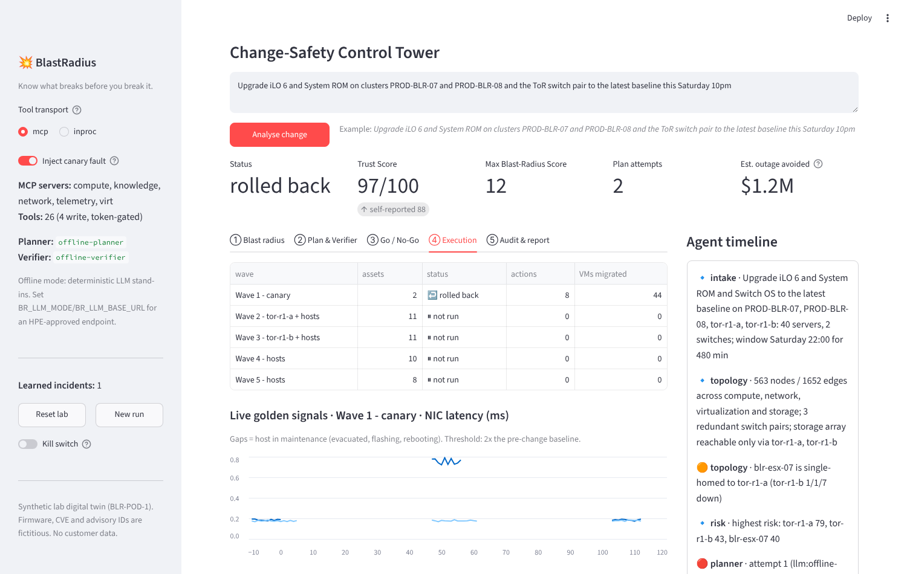
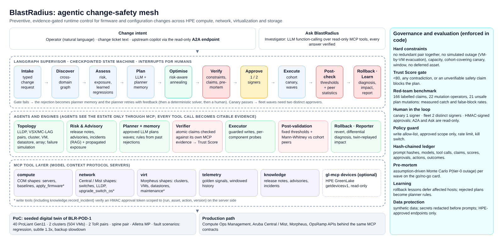

# BlastRadius: agentic change-safety mesh

**Know what breaks before you break it.**
HPE Agentic AI Hackathon India 2026 · Track 3: Autonomous Infrastructure Optimization (pre/during/post upgrade validation)

BlastRadius is a LangGraph multi-agent system, connected to infrastructure through the Model Context Protocol (MCP), that turns a firmware or configuration upgrade into a verified, staged and reversible operation:

1. **Discover**: build a live dependency graph across compute, network, virtualization and storage.
2. **Assess**: score every asset from release notes, advisories, incidents and the *simulated* impact on everything downstream of it.
3. **Plan and verify**: an LLM proposes canary waves; deterministic constraints reject unsafe waves; an independent **Verifier** checks every claim in the plan against tool evidence and computes a **Trust Score**.
4. **Approve**: a human signs a one-page go/no-go card (two signers for fleet-wide waves).
5. **Execute and validate**: policy-guarded MCP writes run wave by wave, golden signals are compared before, during and after each wave, and any regression auto-halts and rolls back. The failure becomes a lesson that protects the next change.

Every step lands in a hash-chained audit ledger.



## Quick start

```bash
pip install -r requirements.txt

python -m blastradius ui                              # Control Tower at http://localhost:8501
python -m blastradius demo --auto-approve --reset     # the whole story in the terminal
python -m blastradius demo --faults off --auto-approve --reset   # clean run, all 5 waves
python -m pytest -q                                   # 38 tests
docker compose up --build                             # same UI in a container
```

No model endpoint is needed for the demo: `BR_LLM_MODE=offline` (the default) swaps the LLM calls for deterministic stand-ins (see [Honest scope](#honest-scope)). Everything else (MCP servers, graph, constraints, Verifier, approvals, execution, rollback, ledger) is the real code path.

## The demo story (5 minutes, see [docs/DEMO_SCRIPT.md](docs/DEMO_SCRIPT.md))

Intent: *"Upgrade iLO 6 and System ROM on clusters PROD-BLR-07 and PROD-BLR-08 and the ToR switch pair to the latest baseline this Saturday 10pm."* That is 40 servers and 2 switches in a seeded digital twin of one Bangalore pod (504 VMs).

| Step | What happens |
|---|---|
| Hidden dependency | LLDP shows `blr-esx-07` (it runs `payments-db-01`) has had its second uplink err-disabled for weeks. The Risk agent's failure simulation makes `tor-r1-a` the riskiest asset (79/100). |
| First plan blocked | The planner batches both VSX members into wave 1. Simulation: **504 VMs lose service**, because the Alletra array hangs only off the R1 ToR pair, so the *other* cluster loses its datastores too. 12 constraint violations. |
| Hallucination caught | The Verifier contradicts *"System ROM U54 v2.32 remediates SYN-CVE-2026-1105"* (the release notes list other CVEs; the advisory says it is fixed in iLO 6 v1.66) along with 4 other claims. **Trust Score 0 against a self-reported 91.** |
| Re-plan accepted | Staggered VSX members, the single-homed host co-scheduled with its switch, at most 5 hosts per cluster per wave. **Trust Score 97** (7 supported, 1 unverifiable). |
| Human gate | Go/no-go card, HMAC-signed approval, scoped write tokens. |
| Canary regression | ROM U54 v2.32 combined with NIC firmware 229.x raises NIC latency **4.1x** on `blr-esx-03`. The wave auto-halts, write access is revoked, the wave is rolled back and signals recover. *Estimated outage avoided: $1.2M (illustrative).* |
| Learning | Differential diagnosis: iLO 1.64 is exonerated (the healthy control host got it too) and ROM + NIC 229.x is blamed. Press **New run**: the **20 affected DL380 hosts are deferred** and the remaining 22 assets complete safely. |
| Audit | Signed report; ledger verified; *Simulate tampering* breaks the chain on a copy. |

| Plan & Verifier | Canary rollback |
|---|---|
|  |  |

## Architecture



| Module | Role |
|---|---|
| `blastradius/workflow.py` | LangGraph supervisor: checkpointed state machine with interrupts for the two approval gates |
| `blastradius/agents/` | Intake, Topology, Risk & Advisory, Wave Planner, **Verifier**, Executor, Post-Validation, Rollback, Reporter |
| `blastradius/mcp_layer.py`, `tools/` | 5 MCP servers (compute, network, virt, telemetry, knowledge; 26 tools) and the ToolBus. Every call is recorded as evidence `EV-xxxx` |
| `blastradius/topology.py` | NetworkX cross-domain graph and failure simulation (network isolation, storage reachability, cluster capacity), plus the Blast-Radius Score |
| `blastradius/constraints.py`, `solver.py` | Hard constraints in code, and a deterministic wave solver used as fallback |
| `blastradius/ledger.py`, `approval.py`, `policy.py` | Hash-chained ledger, HMAC approvals and write tokens, allow-list, rate limit, kill switch, redaction |
| `blastradius/twin.py`, `data/` | Seeded digital twin (COM / Central / Mist / Morpheus / OpsRamp-shaped JSON) with fault injection, and a synthetic knowledge base |
| `ui/app.py` | Streamlit Control Tower |
| `policy/policy.yaml` | Every threshold the system enforces |

### How the Verifier scores trust

1. A separate model, using its own prompt at temperature 0, splits the planner's rationale into atomic, typed claims (`fixes_cve`, `pair_safe_together`, `all_dual_homed`, `cluster_capacity`, `no_planned_outage`, `install_order`, `in_window`, ...).
2. Each typed claim goes to a deterministic checker that gathers **its own** evidence over MCP (release notes, advisories, LLDP, cluster capacity, independent re-simulation). Untyped claims go to an LLM judge that may only cite retrieved evidence; if it cites nothing, its verdict is downgraded to *Unverifiable*.
3. `Trust = 100 × Σ(weight × value) / Σ weight − 15 × contradictions`, where value is Supported 1, Unverifiable 0.5, Contradicted 0, and weight is safety 3, factual 2, informational 1.
4. A plan reaches a human only if the constraints pass, Trust ≥ 80 and there are **no** contradictions. Otherwise the planner retries with the violations and contradicted claims as feedback, then the deterministic solver takes over, then the change is escalated.

## Responsible AI and governance

- **Human in the loop:** analysis runs automatically; the canary needs 1 signer; fleet waves need 2 *distinct* signers. Nothing is written without a signed approval, and every write tool checks an HMAC token scoped to `(run, asset, action)` on the MCP server side.
- **Grounding:** every claim links to evidence; *Unverifiable* is the default; any *Contradicted* claim blocks.
- **Deterministic guardrails:** redundancy, capacity, canary and window rules are code, never prompt text. A write allow-list, approved scope only, a per-wave rate limit and a kill switch (`BR_KILL_SWITCH=on`, or the toggle in the UI) back them up.
- **Auditability:** the ledger stores prompt hashes, model IDs, tool calls, claims, scores, approvals, actions and outcomes. `python -m blastradius ledger verify` recomputes the chain.
- **Data protection:** synthetic data only. Secrets and e-mail addresses are redacted before any prompt. Configure only HPE-approved LLM endpoints.

## Using an HPE-approved LLM

Copy `.env.example` to `.env` and set:

```bash
BR_LLM_MODE=openai            # OpenAI-compatible: NVIDIA NIM on HPE Private Cloud AI, or a ChatHPE / GenAI Hub gateway
BR_LLM_BASE_URL=https://<approved-endpoint>/v1
BR_LLM_API_KEY=...
BR_LLM_MODEL=<approved model>
BR_VERIFIER_MODEL=<a different approved model>   # recommended: independent blind spots
# BR_LLM_MODE=azure  uses the Azure OpenAI URL scheme (deployment name in BR_LLM_MODEL)
```

Prompts are in `blastradius/prompts/`. LLM outputs are validated against Pydantic schemas, with up to two repair round-trips. If the planner keeps failing, the deterministic solver takes over and the plan is marked `deterministic-solver`.

Optional: set `BR_GL_MCP_URL` or `BR_GL_MCP_CMD` to attach HPE's official GreenLake MCP server (`HewlettPackard/gl-mcp`) read-only. The Topology agent will list the workspace's devices and match them by serial number. This adapter has **not** been tested against a live gl-mcp deployment.

## Honest scope

- **Execution is simulated.** Write tools act on a digital twin with an injected fault. Real COM, Central or Mist writes would need lab hardware and change approvals.
- **Offline mode** replaces the LLM with deterministic stand-ins so the demo is reproducible. The planner stand-in deliberately behaves like an ungrounded model on its first attempt (it batches the VSX pair and repeats a false CVE claim) and like a corrected model after feedback. With a live endpoint the model's behaviour will vary, and the guardrails are what make that safe.
- **Synthetic data.** Firmware versions, CVE IDs (`SYN-CVE-…`), advisories (`ADV-SYN-…`) and incidents are fictitious.
- **Business figures** ($1.2M per avoided Sev-1) are illustrative: 4 h × the ITIC 2024 floor of $300K/h, configurable in `policy.yaml`.
- Retrieval is BM25 (no vector DB); Chroma/pgvector is planned for Phase 2.

## Hackathon deliverables

- Abstract (official template): [`docs/abstract/BlastRadius_Abstract.docx`](docs/abstract/BlastRadius_Abstract.docx), generated by `python scripts/build_abstract.py`. Add team member names before uploading.
- Demo video script: [`docs/DEMO_SCRIPT.md`](docs/DEMO_SCRIPT.md)
- Open-source disclosure: [`OSS_DISCLOSURE.md`](OSS_DISCLOSURE.md)
- A2A agent card: [`a2a/agent-card.json`](a2a/agent-card.json)
