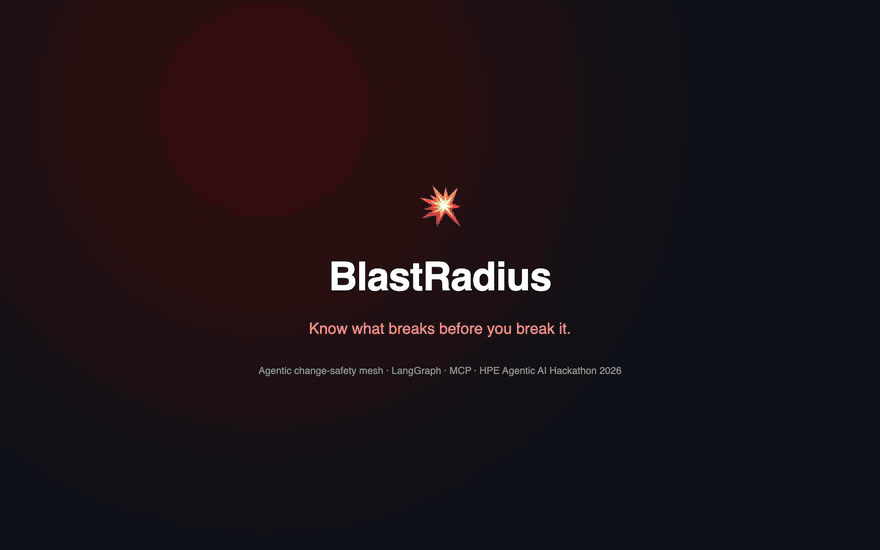

# BlastRadius: agentic change-safety mesh

**Know what breaks before you break it.**
HPE Agentic AI Hackathon India 2026 · Track 3: Autonomous Infrastructure Optimization (pre/during/post upgrade validation)

<a href="media/BlastRadius_explainer_5min.mp4"></a>

**▶ [Watch the 5-minute explainer video with narration](media/BlastRadius_explainer_5min.mp4)** (the preview above is a silent highlight reel; click it for the full video) · [download from the release](https://github.com/DHARANI2D/blast-radius/releases/download/demo-video/BlastRadius_explainer_5min.mp4)

BlastRadius is a LangGraph multi-agent system, connected to infrastructure through the Model Context Protocol (MCP), that plans a firmware or configuration upgrade as verified, staged canary waves with automatic halt and rollback:

1. **Discover** a dependency graph across compute, network, virtualization and storage from MCP tool calls.
2. **Assess** every asset from release notes, advisories, incidents (including lessons it learned itself) and the *simulated* impact on everything downstream of it.
3. **Plan, optimise and verify.** An LLM proposes canary waves, helped by rules it learned from earlier rejected plans. A risk-aware optimiser re-sequences them under the same hard constraints. Code rejects unsafe waves, and an independent **Verifier** checks every claim against tool evidence it gathers itself and computes a **Trust Score**. A Monte Carlo **pre-mortem** estimates the chance of a tier-0 outage.
4. **Approve.** A human signs a one-page go/no-go card (two signers for fleet-wide waves).
5. **Execute and validate.** A canary covering every configuration cohort runs first. Golden signals are judged against fixed thresholds *and* statistically against un-upgraded peers over the same minutes. Any regression auto-halts and rolls back. A probe after each flashed component points to the culprit, and the failure becomes a lesson that protects the next change.

Every step lands in a hash-chained audit ledger. A red-team benchmark measures how well the Verifier and the constraint checker catch false claims and unsafe plans.

## Quick start

```bash
pip install -r requirements.txt

python -m blastradius ui                                    # Control Tower at http://localhost:8501
python -m blastradius demo --auto-approve --reset           # the whole story in the terminal
python -m blastradius demo --auto-approve                   # "New run": the learning re-run
python -m blastradius demo --faults subtle --auto-approve --reset   # a 1.3x regression only the statistics catch
python -m blastradius redteam                               # Verifier red-team benchmark (about 5 s)
python -m pytest -q                                         # 203 tests
```

Other commands: `memory show|clear` (planner memory), `greenlake doctor|devices` (HPE GreenLake MCP), `a2a-serve` (read-only A2A endpoint), `mcp-serve <domain>`, `tools`, `ledger verify|show`, `reset`. Fault scenarios: `on` (default), `off`, `subtle`, `backup`, `on+backup`, `subtle+backup`. `docker compose up --build` runs the UI in a container.

No model endpoint is needed for the demo. `BR_LLM_MODE=offline` (the default) replaces the LLM calls with deterministic stand-ins, labelled as such on screen (see [Honest scope](#honest-scope)). Everything else is the real code path: MCP servers, graph, constraints, optimiser, Verifier, statistics, approvals, execution, rollback, memory and ledger.

## The demo story

Intent: *"Upgrade iLO 6 and System ROM on clusters PROD-BLR-07 and PROD-BLR-08 and the ToR switch pair to the latest baseline this Saturday 10pm."* That is 40 servers and 2 switches in a seeded digital twin of one Bangalore pod (504 VMs).

| Step | What happens |
|---|---|
| Hidden dependency | LLDP shows `blr-esx-07` (it runs `payments-db-01`) has had its second uplink err-disabled for weeks. The failure simulation makes `tor-r1-a` the riskiest asset (79/100). |
| First plan blocked | The first draft (offline: a scripted ungrounded draft, labelled as such) batches both VSX members into wave 1. Simulation: **504 VMs lose service**, because the Alletra array hangs only off the R1 ToR pair, so the *other* cluster loses its datastores too. 13 constraint violations. |
| Hallucination caught | The Verifier contradicts *"System ROM U54 v2.32 remediates SYN-CVE-2026-1105"* (the release notes list other CVEs; an advisory says the fix is iLO 6 v1.66) and 4 other claims. **Trust Score 0 against a self-reported 91.** The rejection becomes **15 planner-memory rules**. |
| Re-plan, optimise, verify | Staggered VSX members, the single-homed host scheduled with its switch, at most 5 hosts per cluster per wave, and a **cohort-coverage canary** (one host from each of 3 configuration cohorts). The **optimiser** moves `tor-r1-a` and its single-homed payments host from wave 2 to wave 5, after 81% of the plan has been validated (objective -16%). The planner re-explains the final waves: **Trust Score 98**. |
| Go / no-go | Canary covers 3/3 cohorts (a risk-ranked canary would cover 2/3). **Pre-mortem** (assumption-driven): P(tier-0 outage) **0.75%** for the accepted plan vs **100%** for the first draft. HMAC-signed approval, scoped write tokens. |
| Canary regression | ROM U54 v2.32 with NIC firmware 229.x raises NIC latency **3.9x** on `blr-esx-01`. Fixed thresholds and the **statistical judge** agree (4.17x vs 15 cohort peers over the same minutes, Mann-Whitney p < 0.001; the exact test bottoms out at 4.4e-16 for 10 vs 150 samples, and minute samples from one host are autocorrelated, so read p as evidence strength). Auto-halt, write access revoked, rollback, signals recover. |
| Diagnosis and counterfactual | A probe after each component shows `blr-esx-01` was normal after iLO and broke right after the ROM. Control `blr-esx-03` (same model, NIC 230.x) stayed healthy, so the lesson is scoped to **NIC 229.x**, with the fix. A conventional risk-ranked canary would have passed: wave 2 would have flashed 5 affected hosts, including the one running `payments-db-01`, and waves 3-5 another 11 had its post-check missed it (16 hosts, 176 VMs). |
| Business impact | Replayed on the twin: **~$64K avoided** against the conventional process (risk-ranked canary on the greedy ordering: Sev-1, 13 degraded VM-hours incl. tier-0), versus $458 for what actually happened. With the optimiser's ordering alone it would have been ~$4.6K. If the fleet post-check had missed it for 4 h: ~$409K. All rates are illustrative (policy.yaml), not measured costs. |
| Learning | Press **New run**: memory gives the planner 12 rules and **attempt 1 passes first time**. Exactly the **16 hosts still on NIC 229.x are deferred**. The optimiser cuts the remaining plan from 7 waves to 5 (231 → 165 min), and all 26 assets complete. |
| Analysis time | Intake to go/no-go card (two plan attempts, 2,500 optimiser iterations, verification, pre-mortem) takes **about 3 s** of compute with the offline stand-ins: 2.8 s in-process, 3.4 s over MCP (98 tool calls; the optimiser alone about 1 s). End-to-end time with a hosted model has not been measured yet (target: under 5 minutes). |
| Red team | On a corpus generated from the twin: 93/97 false claims contradicted, 0 dangerous misses, 0/69 false blocks, 21/21 unsafe plan mutations rejected, 8/8 injected hallucinations caught. It measures the gate, not real-world recall. |
| Ask BlastRadius | *"Why is tor-r1-a the riskiest asset?"* is answered from MCP tool calls only, every sentence cited, and the answer re-verified. |

## Architecture

| Module | Role |
|---|---|
| `blastradius/workflow.py` | LangGraph supervisor: intake, discover, assess, plan, **optimise**, verify, approve (interrupt), execute, post-check, rollback, report, escalate |
| `blastradius/agents/` | Intake, Topology, Risk & Advisory, Wave Planner, **Verifier**, Executor, Post-Validation, Rollback, Reporter, **Investigator** |
| `blastradius/mcp_layer.py`, `tools/` | 5 MCP servers (compute, network, virt, telemetry, knowledge; 26 tools) and the ToolBus. Every call is recorded as evidence `EV-xxxx` |
| `blastradius/topology.py` | Cross-domain graph and failure simulation (isolation, storage reachability, VM-by-VM evacuation), Blast-Radius Score |
| `blastradius/constraints.py`, `solver.py`, `optimizer.py` | Hard constraints, a deterministic wave solver (fallback), and the risk-aware simulated-annealing optimiser |
| `blastradius/cohorts.py`, `canary_stats.py` | Configuration cohorts, cohort-coverage canary, and the statistical canary judge (Mann-Whitney U against cohort peers) |
| `blastradius/premortem.py`, `business.py` | Monte Carlo pre-mortem, and business impact replayed on the twin |
| `blastradius/memory.py` | Planner memory: rules from rejected plans, retrieval, first-attempt pass rate |
| `blastradius/redteam.py` | Verifier red-team benchmark: labelled corpus, 22 mutation operators, plan mutations, injection |
| `blastradius/a2a_server.py`, `greenlake.py` | Read-only A2A endpoint, and the adapter for HPE's GreenLake devices MCP server |
| `blastradius/ledger.py`, `approval.py`, `policy.py` | Hash-chained ledger, HMAC approvals and write tokens, allow-list, rate limit, kill switch, redaction |
| `blastradius/twin.py`, `data/` | Seeded digital twin (COM / Central / Mist / Morpheus / OpsRamp-shaped JSON), fault scenarios, synthetic knowledge base |
| `ui/app.py` | Streamlit Control Tower |
| `policy/policy.yaml` | Every threshold, weight and business rate the system uses, each business value marked illustrative or sourced |

### How the Verifier scores trust

1. The Verifier's extractor, with its own prompt at temperature 0 (a separate model when `BR_VERIFIER_MODEL` is set, recommended; otherwise the planner's model), splits the planner's rationale into atomic, typed claims (`fixes_cve`, `pair_safe_together`, `all_dual_homed`, `cluster_capacity`, `canary_covers_cohorts`, `no_planned_outage`, `install_order`, `in_window`, ...).
2. Each typed claim goes to a deterministic checker that gathers **its own** evidence over MCP: release notes, advisories, LLDP, cluster capacity, inventory, and independent re-simulation. Untyped claims go to an LLM judge that sees the evidence the sentence cites plus retrieved documents. If the judge cites nothing, its verdict is downgraded to *Unverifiable*.
3. `Trust = 100 × Σ(weight × value) / Σ weight − 15 × contradictions`, where value is Supported 1, Unverifiable 0.5, Contradicted 0, and weight is safety 3, factual 2, informational 1.
4. A plan reaches a human only if the constraints pass, Trust ≥ 80, there are **no** contradictions, and **no safety-sounding sentence is left unverifiable**. Otherwise the rejection is stored as planner memory and the planner retries with the feedback; then a deterministic solver takes over; then a human is asked.
5. When the optimiser changes the waves, the planner re-explains the final waves and the Verifier checks that explanation. It also checks the planner's own first rationale against the draft waves it described, and the attempt passes only if both pass, so a false claim in the draft is rejected and learned even when the optimiser improves the waves. The approval signs the hash of the plan that will actually run; the card shows both Trust Scores.

### Red-team benchmark: how we know the Trust Score works

`python -m blastradius redteam` (seed 7, about 5 s) generates a labelled corpus from the twin and the knowledge base. Any change to the Verifier is measured against it.

| Measure | Result |
|---|---|
| False typed claims contradicted (22 mutation operators) | **93/97** (96%, 95% CI 90-98%); the other 4 flagged Unverifiable |
| Dangerous misses (false claim labelled Supported) | **0** (95% CI 0-4%) |
| False blocks on true claims | **0/69** (95% CI 0-5%) |
| Unsafe plan mutations rejected by the hard constraints | **21/21** (95% CI 84-100%) |
| Injected hallucinations caught / plans blocked | **8/8** / 8/8 |
| Offline claim-extractor paraphrase coverage (canonical / dev / held-out) | 100% / 100% / 11% |
| False sentences that still pass the gate, labelled Unverifiable (canonical / dev / held-out) | 4/97 / 8/194 / 111/194 |

The benchmark found and fixed 2 dangerous misses, 3 crashes and 6 false blocks in the Verifier and extractor. It also found a missing hard constraint (re-scheduling a host deferred by a learned regression); that `DEFERRED` rule now exists. The weak held-out paraphrase coverage belongs to the offline regex extractor that stands in for the model. A false sentence it cannot type is labelled Unverifiable, which lowers the Trust Score but does not by itself block: the safety-claim gate blocks it only when it uses safety language ("safe", "no downtime", "without impact", "at once", "in parallel", "hitless", ...). The last row counts the false sentences that still pass; none of them is labelled Supported. In the UI you can inject a labelled hallucination into the accepted plan and watch it get caught.

Ground truth is read from the raw twin and knowledge records, not through the checkers, with two exceptions: `in_window` labels come from the same plan duration model (`constraints.wave_duration`) and `canary_covers_cohorts` labels from the same cohort builder (`cohorts.build`) that the Verifier's checkers use. Those two rows are consistency checks, not independent measurements: a bug shared by the checker and that code would not show up in them. The report marks them as such.

### Canary: cohort coverage, statistics and diagnosis

- **Configuration cohorts** (`cohorts.py`). Target hosts are grouped by model plus the major version of every firmware component the change does *not* touch, here NIC 229.x vs 230.x. A conventional lowest-risk canary picks dev/CI boxes that already got new NIC firmware, and covers only 2 of 3 cohorts.
- **Cohort-coverage canary.** One eligible host (dual-homed, no tier-0/1 workloads) from each cohort is required. `CANARY_COVERAGE` is a hard constraint and a typed Verifier claim.
- **Statistical judge** (`canary_stats.py`). Each canary host is normalised to its own pre-change median and compared with un-upgraded hosts of the same cohort over the *same minutes*, using a one-sided Mann-Whitney U test with an exact permutation p-value at the demo sample sizes (and whenever one tie group dominates; the normal approximation beyond that is floored at the smallest attainable p) and a difference-in-differences effect size. Either a fixed-threshold FAIL or a statistical FAIL rolls back.

| Scenario | Fixed 2x rule | Fixed 1.3x rule | Statistical judge |
|---|---|---|---|
| Demo regression (~4x) | catches | catches | catches (p < 0.001) |
| Subtle regression (1.36x) | **misses** | misses | **catches** (p < 0.001) |
| Backup job slows every host | passes | **false alarm on all 3 canary hosts** | passes (peers slowed down too) |

- **Per-component probe and controls.** A probe after each flashed component points to the culprit on the regressed host itself. Healthy canary hosts that got the same version act as controls that scope the lesson.

### Optimiser, pre-mortem, business impact, memory

- **Optimiser** (`optimizer.py`). Simulated annealing over move, swap, merge, split and reorder moves, under the same per-wave rules as the constraint checker, with a final full check. The objective is J = minutes + Σ Blast-Radius Score + w·progressive exposure + w·waves; exposure penalises risky or tier-0-carrying assets in early waves. On the first run it reorders (-16%); on the learning re-run it cuts 7 waves to 5. The canary is never changed.
- **Pre-mortem** (`premortem.py`). Per wave, assets fail to come back and other infrastructure fails in the background, at **assumed** rates scaled by the risk score. Single failures are counted exactly and multi-failure worlds are sampled. It reports P(tier-0 outage), the share attributable to the change, expected and P95 VMs lost, and the most likely and most severe scenarios. All of it is assumption-driven and labelled so.
- **Business impact** (`business.py`). Replays the conventional process on the twin (risk-ranked canary, greedy ordering): when affected hosts return to service, when a post-check would detect the regression, and how many degraded VM-hours each tier accumulates. Cost uses per-tier rates, a Sev-1 and diagnosis hours: illustrative rates (policy.yaml, `business:`). No company-wide downtime rate (such as ITIC's $300K/h) is applied: those describe a whole business outage, not one pod's degraded VMs.
- **Planner memory** (`memory.py`). Every rejected attempt becomes normalised, evidence-backed rules, such as *"Never put tor-r1-a and tor-r1-b in the same wave..."* and *"Do not claim ROM U54 v2.32 fixes SYN-CVE-2026-1105..."*. Rules relevant to the next change are retrieved into the planner's prompt, and the first-attempt pass rate is tracked with and without memory.

### Interoperability

- **Ask BlastRadius** (`agents/investigator.py`). With a live model, the LLM chooses read-only MCP tools through function calling (up to six rounds), cites the evidence, and the Verifier re-checks the answer. Write tools are not exposed.
- **A2A endpoint** (`python -m blastradius a2a-serve`). An upstream copilot sends a change intent and gets the verified go/no-go card back with state `input-required`; an intent that names no known asset comes back `rejected` with the reason. There is no A2A method that approves. It implements JSON-RPC send/get/cancel (slash and PascalCase method names); it has not been run against an official conformance suite.
- **HPE GreenLake MCP** (`greenlake.py`). Aligned with HPE's `greenlake-devices-mcp` server (`getdevicesv1`, stdio, OAuth via `GREENLAKE_*` variables, paging, select). Not yet run against a live workspace. To try it:

  ```bash
  pip install greenlake-devices-mcp
  export GREENLAKE_CLIENT_ID=... GREENLAKE_CLIENT_SECRET=... GREENLAKE_WORKSPACE_ID=...
  export BR_GL_MCP_CMD="python -m greenlake_devices_mcp"   # optional: BR_GL_MCP_FILTER, _PAGE_SIZE, _MAX_PAGES, _TIMEOUT_S
  python -m blastradius greenlake doctor    # readiness, no network call
  python -m blastradius greenlake devices   # the read-only device listing
  ```

## Responsible AI and governance

- **Human in the loop:** analysis is automatic; the canary needs 1 signer; fleet waves need 2 *distinct* approver names. The PoC signs those names with one service key, so it cannot prove two different people approved; production needs per-user (SSO) identities. Every write tool checks an HMAC token scoped to `(run, asset, action, version)` on the MCP server side: the canary approval grants only wave 1, the fleet approval the remaining waves, firmware writes only at the approved target version (or the captured previous version for a rollback), and every grant is revoked when the run ends. Recording a learned incident is a token-gated write too: the Reporter gets a token for that run and incident only after a rollback, and an incident recorded by another run is never overwritten. The A2A endpoint and the Investigator are read-only.
- **Grounding and evaluation:** every claim links to evidence; Unverifiable is the default; contradictions and unverifiable safety claims block. The red-team benchmark measures the gate.
- **Deterministic guardrails:** redundancy, capacity, cohort coverage, deferral and window rules are code, never prompt text. A write allow-list, approved scope only, a per-wave rate limit and a kill switch back them up.
- **Honest numbers:** probabilities and dollars are labelled assumption-driven or illustrative wherever they appear, with the assumptions listed.
- **Auditability:** the ledger stores prompt hashes, model IDs, tool calls, claims, scores, pre-mortem assumptions, approvals, actions and outcomes. `python -m blastradius ledger verify` recomputes the chain, which is keyed with `BR_SIGNING_KEY` (HMAC-SHA256) and checked against a signed head anchor beside the database, so edited, re-chained or deleted newest entries all fail verification for anyone without the key. The anchor sits beside the database, so a production deployment should also keep it off-host (e.g. WORM storage).
- **Data protection:** synthetic data only. Secrets and e-mail addresses are redacted before any prompt. Configure only HPE-approved LLM endpoints.

## Using an HPE-approved LLM

Copy `.env.example` to `.env` and set the values below. `blastradius/config.py` reads `.env` from the repo root (or the file named by `BR_ENV_FILE`) at start-up for the CLI, the UI and the A2A endpoint; a variable already set in the environment always wins, and an empty value keeps the code default.

```bash
BR_LLM_MODE=openai            # OpenAI-compatible: NVIDIA NIM on HPE Private Cloud AI, or a ChatHPE / GenAI Hub gateway
BR_LLM_BASE_URL=https://<approved-endpoint>/v1
BR_LLM_API_KEY=...
BR_LLM_MODEL=<approved model>
BR_VERIFIER_MODEL=<a different approved model>   # recommended: independent blind spots
# BR_LLM_MODE=azure  uses the Azure OpenAI URL scheme (deployment name in BR_LLM_MODEL)
```

Prompts are in `blastradius/prompts/`. LLM outputs are validated against Pydantic schemas, with up to two repair round-trips. If the planner keeps failing, the deterministic solver takes over and the plan is marked `deterministic-solver`. `python -m blastradius redteam --extractor configured` measures the configured model as the claim extractor.

## Honest scope

- **Execution is simulated.** Write tools act on a digital twin with injected faults. Real COM, Central or Mist writes would need lab hardware and change approvals.
- **Rollback feasibility is not checked yet.** On the twin, rollback re-flashes the captured previous version. On real ProLiant servers, iLO's downgrade policy can require an extra privilege or forbid downgrades outright, and iLO and System ROM versions depend on each other, so a production version must check both before approval.
- **Offline mode is a stand-in, and says so.** Its first planner draft is scripted to make the mistakes an ungrounded model makes, and is labelled *"scripted ungrounded draft"* on screen. Its memory-conditioned first draft switches to the corrected wording when retrieved rules cover those mistakes, so the memory gain in offline mode is by construction. With a live model, rules reach the model only through the prompt, and the gain has to be measured. The Investigator's offline router and the judge's offline lexical-grounding check are stand-ins too. Record the demo with an HPE-approved model.
- **Numbers are model outputs.** Pre-mortem probabilities come from assumed failure rates. Dollar figures use illustrative rates (policy.yaml), listed with their source in the UI and the report. Statistical p-values pool samples from control hosts, and minute samples from one host are autocorrelated, so read them as evidence strength, not exact error rates.
- **Not yet run live:** the GreenLake adapter (no credentials here) and the live-model path end to end (no approved endpoint here; it is tested against fake OpenAI-compatible servers).
- **Synthetic data.** Firmware versions, CVE IDs (`SYN-CVE-…`), advisories (`ADV-SYN-…`) and incidents are fictitious.
- Retrieval is BM25 (no vector DB); Chroma/pgvector is planned for Phase 2.

## Other files

- Open-source disclosure: [`OSS_DISCLOSURE.md`](OSS_DISCLOSURE.md)
- A2A agent card: [`a2a/agent-card.json`](a2a/agent-card.json), the output of `python -m blastradius a2a-card` (the card `a2a-serve` serves at its default address; regenerate the file with that command)
